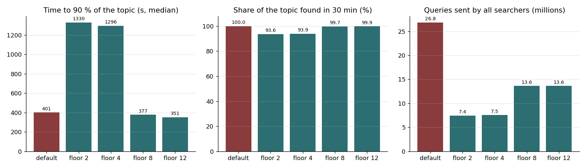
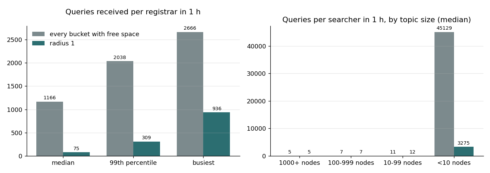
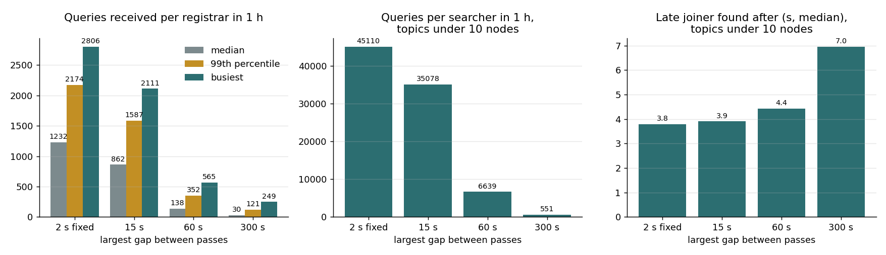
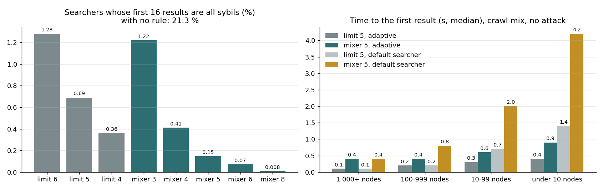
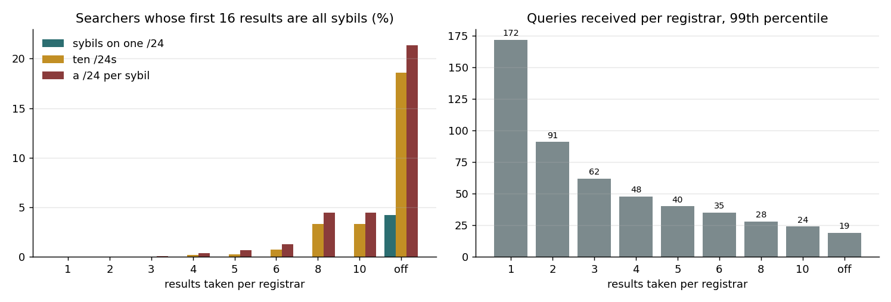

# Adaptive search parameters

The adaptive topic search has three settings: the yield floor, the aux radius and the pass back-off. The search filter adds a fourth: the number of registrars whose results a search mixes. This document gives the selected value for each setting and the model runs behind it.

| | |
|---|---|
| model | datahop/topdisc-sim, `searchsim.world`, with the aux-node fix |
| runs | 63 reruns of the first evaluation, 271 runs for the result mixer |
| size | 30 000 nodes, with 100 000 and 250 000 for scale |
| selected | floor 8, aux radius 1, back-off 60 s, results mixed over 5 registrars |

## Selected values

| Setting | Value | What it gives | What it costs |
|---|---|---|---|
| Yield floor | 8 | the speed of the default searcher (377 s to 90 % of a topic, default 401 s) with half of its queries; the busiest registrar gets 2 000 queries, against 150 000 with the default searcher | twice the queries of floor 4, which is three times slower |
| Aux radius | 1 | 13 times fewer queries in a mix of topic sizes, every small topic still found in full | nothing measured |
| Pass back-off | 60 s | 5 times fewer queries at the busiest registrar | a late joiner in a small topic is found 0.6 s later at the median, 10 s later at the 90th percentile |
| Result mixer | 5 registrars | a full eclipse of 16 peer slots needs five sybil registrars in a row; 0.15 % of searchers are eclipsed with 20 % sybils, 21.3 % with no rule | six queries to fill 16 slots, against two or three; the first result comes 0.2 to 0.5 s later with the adaptive search |

The first three values are the defaults of go-ethereum PR #144. The fourth is a constant in PR #140. Section 4 gives the conclusions, sections 3.2 to 3.7 the runs behind each value.

## 1. The problem

The first evaluation of these settings used a model with a defect. A registrar adds helper nodes to each reply, one for each distance the searcher asks for. The search and registration tables fill from these aux nodes. The model took the aux nodes from the wrong part of the registrar's routing table. Only 16 % of them were at the distance the searcher asked for.

Every result of the first evaluation depends on how the tables fill. Its conclusions were:

- Floors 2 to 12 give the same result, so floor 4 is sufficient.
- An aux radius of 1 reduces the load but breaks small topics.
- A pass back-off of 60 s is useful for the default searcher.

The model fix is one line. All 63 runs of the first evaluation ran again with it, with no other change. The first two conclusions do not hold with the fixed model.

## 2. The settings

The yield floor is `SearchYieldFloor` in the code. The search has an active bucket. It reads the number of ads in each reply from that bucket. When the median of the last four replies is below the floor, the search moves closer to the topic, where registrars hold more ads. A higher floor makes the search settle closer to the topic.

The aux radius is `SearchAuxRadius`. Every reply to a query carries aux nodes. These are other registrars, which the searcher can ask next. In each query the searcher names the buckets for which it wants aux nodes. Without a radius it names every bucket that has free space. Its table then fills with registrars at all distances, and it queries all of them. With radius 1 it names only its active bucket and one bucket on each side. Example: the active bucket is 6, so the searcher asks for aux nodes for buckets 5, 6 and 7.

The pass back-off is `SearchPassBackoff`. A pass is one walk through the search table. The gap between passes is 2 s. After a pass that finds nothing new, the gap doubles, up to this limit. A pass that finds a new result sets the gap to 2 s again. Example: a node in a topic of 5 nodes finds the 4 others in the first seconds. Without a back-off it then repeats its pass every 2 s and finds nothing.

The result mixer is a constant in the search filter (`searchMixRegistrars`). The filter keeps the new results of each registrar in a queue of its own. While five registrars have results in their queues, the search hands out one result from each registrar in turn. It hands out the results that are left when the pass ends. No result is lost.

Four more things were tested and need no setting: the number of aux nodes per reply, the size of a search bucket, the number of buckets, and a rule that ends a pass after some replies with nothing new.

## 3. Evaluation

### 3.1 Scenarios

| Scenario | Population | Search | Used in |
|---|---|---|---|
| One topic, continuous | 30 000 nodes, all in one topic, all registered | 918 nodes search for 30 min and do not stop | 3.2, 3.3 |
| Crawl mix, connection-driven | 30 000 nodes in 100 topics with the sizes of the 2026-09-18 crawl, half of them registered | every node searches until it has 16 results, for 1 h | 3.2, 3.4 |
| Crawl mix with late joiners | the same, but 20 % of the registrants start in the search phase | the same | 3.5, 3.6 |
| Dense topic with sybils | 30 000 nodes, one topic, half of the nodes registered, 20 % of the nodes are sybils | every honest node searches until it has 50 results | 3.7 |
| Scale | 100 000 and 250 000 nodes, one topic | about 1 000 nodes search for 30 min | 3.8 |

Every searcher has one query in flight. The round-trip time is 60 ms. An ad lives for 15 min. The topic size classes of the crawl mix are 1 000 and more nodes, 100 to 999, 10 to 99, and fewer than 10.

### 3.2 Yield floor

*One topic of 30 000 nodes, continuous search for 30 min. Red is the default searcher, green the adaptive search with the floor shown.*

| Searcher | Half of the topic (s) | 90 % of the topic (s) | Found in 30 min | Reach 99 % | Queries, total | Queries per registrar: median / 99th / busiest |
|---|---|---|---|---|---|---|
| default | 105 | 401 | 100 % | all | 26.8 M | 248 / 12 455 / 149 975 |
| floor 2 | 217 | 1 330 | 93.6 % | none | 7.4 M | 254 / 955 / 1 880 |
| floor 4 | 213 | 1 297 | 93.9 % | none | 7.5 M | 259 / 967 / 1 857 |
| floor 8 | 113 | 377 | 99.7 % | all | 13.6 M | 473 / 1 395 / 1 998 |
| floor 12 | 101 | 352 | 99.9 % | all | 13.6 M | 335 / 1 568 / 2 007 |

Floors 2 and 4 are slow. A search with these floors settles far from the topic, where a reply carries about four ads. It needs 1 300 s to find 90 % of the topic, and no searcher finds 99 % in 30 min.

Floors 8 and 12 are as fast as the default searcher. They send half of its queries. The busiest registrar gets 2 000 queries, against 150 000 with the default searcher.

Floors 8 and 12 give the same times and the same total. Floor 8 is the selected value because it is the lowest floor that keeps the speed of the default searcher.

In the crawl mix the floor changes little, because a search stops at 16 results:

| Searcher | Queries to 16 results, by topic size: 1 000+ / 100–999 / 10–99 | Queries per registrar: median / 99th / busiest |
|---|---|---|
| default | 6 / 17 / 51 | 935 / 7 245 / 24 719 |
| floor 4 | 5 / 7 / 11 | 1 166 / 2 038 / 2 666 |
| floor 8 | 4 / 6 / 9 | 1 170 / 2 041 / 2 644 |
| floor 12 | 4 / 5 / 9 | 1 170 / 2 041 / 2 621 |

### 3.3 Table shape

Three changes to the shape of the search table give the same result as floor 4 without them. All figures are within 1 %.

| Change | 90 % of the topic (s) | Found in 30 min | Queries, total | Busiest registrar |
|---|---|---|---|---|
| none (floor 4) | 1 297 | 93.9 % | 7.5 M | 1 857 |
| 16 aux nodes per reply (was 8) | 1 308 | 93.9 % | 7.5 M | 1 863 |
| 32 nodes per bucket (was 16) | 1 301 | 93.9 % | 7.6 M | 1 882 |
| 14 buckets (was 10) | 1 305 | 93.9 % | 7.5 M | 1 894 |

These values stay as they are.

### 3.4 Aux radius

*Crawl mix, connection-driven, floor 4, 1 h. Grey: the searcher asks for aux nodes for every bucket with free space. Green: radius 1.*

| Aux nodes for | Queries, total | Queries per registrar: median / 99th / busiest | Queries per searcher, topics under 10 nodes | Topics under 10 nodes found in full |
|---|---|---|---|---|
| every bucket with free space | 35.4 M | 1 166 / 2 038 / 2 666 | 45 129 | 100 % |
| radius 1 | 2.7 M | 75 / 309 / 936 | 3 275 | 100 % |

Radius 1 reduces the total number of queries by a factor of 13. The saving comes from the small topics. A topic with fewer than 10 nodes can never give 16 results, so its searchers walk the table for the full hour. With radius 1 a pass has fewer nodes to ask.

The larger topics need almost the same number of queries: 5, 7 and 11 by class without the radius, and 5, 7 and 12 with it. Every small topic is still found in full. The first evaluation found that radius 1 breaks small topics. That was an effect of the defect.

In the one-topic scenario radius 1 changes nothing (1 319 s to 90 %, 7.5 M queries).

### 3.5 Pass back-off

*Crawl mix with 20 % late joiners, floor 4, 1 h.*

| Largest gap | Queries, total | Queries per registrar: median / 99th / busiest | Queries per searcher, topics under 10 nodes | Late joiner found after, topics under 10 nodes: median / 90th (s) | 90 % of the topic, topics of 10–99 nodes (s) |
|---|---|---|---|---|---|
| 2 s, fixed | 37.4 M | 1 232 / 2 174 / 2 806 | 45 110 | 3.8 / 7.4 | 321 |
| 15 s | 26.4 M | 862 / 1 587 / 2 111 | 35 078 | 3.9 / 11.7 | 301 |
| 60 s | 4.5 M | 138 / 352 / 565 | 6 639 | 4.4 / 17.7 | 350 |
| 300 s | 1.1 M | 30 / 121 / 249 | 551 | 7.0 / 26.7 | 510 |

A limit of 60 s reduces the load of the busiest registrar by a factor of 5 and the total by a factor of 8. A late joiner in a small topic is found 0.6 s later at the median and 10 s later at the 90th percentile.

A limit of 300 s reduces the load more. It also slows the search in the smaller topics: the 90 % time of the 10 to 99 class goes from 321 s to 510 s.

In the larger topics the delay to find a late joiner does not change with the limit (about 40 s at the median in the 1 000+ class for every limit).

The back-off also helps the default searcher. With 60 s its busiest registrar goes from 25 696 to 5 028 queries.

### 3.6 Ending a pass early

One more rule was tested: end a pass after 8 or 32 replies in a row that bring nothing new.

| Searcher | Queries per registrar: median / 99th / busiest | Topics under 10 nodes found in full |
|---|---|---|
| floor 4, back-off 60 s | 138 / 352 / 565 | 100 % |
| floor 4, back-off 60 s, end after 8 replies | 12 / 104 / 258 | 100 % |
| floor 4, back-off 60 s, end after 32 replies | 32 / 169 / 349 | 100 % |
| default, back-off 60 s, end after 8 replies | 42 / 196 / 678 | 22 % |

With the adaptive search the rule halves the load of the busiest registrar and keeps every small topic complete. With the default searcher it breaks the small topics. The rule is not in the code. The back-off gives most of the reduction and is safe for the two searchers.

### 3.7 Result mixer

A sybil registrar answers each query with 16 sybil ads. With no protection, one such reply fills all 16 outbound peer slots of a geth node. Two rules were tested. The limit takes at most N results from one registrar and holds the others until the pass ends. The mixer waits until K registrars have results, then hands out one result from each registrar in turn.

*Left: dense topic of 30 000 nodes, 20 % sybils with a /24 each, adaptive search. Right: crawl mix with no attack, median time to the first result, for the limit of 5 and the mixer over 5 registrars, with the adaptive and the default searcher.*

| Rule | First 16 results all sybil | Sybil registrars needed in a row | First result after (s) | Queries to 16 results | Queries per registrar, 99th |
|---|---|---|---|---|---|
| none | 21.3 % | 1 | 0.1 | 2 | 19 |
| limit 6 | 1.28 % | 3 | 0.1 | 4 | 35 |
| limit 5 | 0.69 % | 4 | 0.1 | 4 | 40 |
| limit 4 | 0.36 % | 4 | 0.1 | 5 | 48 |
| mixer, 3 registrars | 1.22 % | 3 | 0.2 | 5 | 24 |
| mixer, 4 registrars | 0.41 % | 4 | 0.2 | 5 | 25 |
| mixer, 5 registrars | 0.15 % | 5 | 0.3 | 6 | 28 |
| mixer, 6 registrars | 0.07 % | 6 | 0.4 | 7 | 32 |
| mixer, 8 registrars | 0.008 % | 8 | 0.5 | 8 | 39 |

The selected rule is the mixer over 5 registrars. It gives about five times fewer full eclipses than the limit of 5, and the registrar load is lower. A search needs six queries to have 16 results, two more than with the limit.

The cost of the mixer is the wait for five replies. When fewer than five registrars have results, the results wait until the pass ends.

| Topic size | First result, adaptive search: limit 5 / mixer 5 (s) | First result, default searcher: limit 5 / mixer 5 (s) |
|---|---|---|
| 1 000+ nodes | 0.1 / 0.4 | 0.1 / 0.4 |
| 100–999 | 0.2 / 0.4 | 0.2 / 0.8 |
| 10–99 | 0.3 / 0.6 | 0.7 / 2.0 |
| under 10 | 0.4 / 0.9 | 1.4 / 4.2 |

With the adaptive search the first result comes at most 0.5 s later. With the default searcher a pass is long, and a topic with fewer than 10 nodes gets its first result after 4.2 s at the median and 9.6 s at the 90th percentile.

The IP limits of the tables decide how much the rule must do. With all sybils on one /24, the tables keep sybil registrars at 4 % of the registrars a searcher asks. The mixer and every limit up to 10 then give no eclipse with the adaptive search. With ten /24s the tables hardly restrict the attacker, because the routing table accepts 10 nodes for each /24. The mixer over 5 registrars gives 0.05 % there, the limit of 5 gives 0.28 %.

No rule has much effect on a sybil majority. With a /24 for each sybil, 20 % to 28 % of the searchers get a sybil majority in their first 16 results with the mixer and with the limit. Honest registrars hold sybil ads in proportion to the sybil share. The admission IP score delays these ads but does not cap them.

The limit rule by value, for three attackers:

*The limit rule. Dense topic, 20 % sybils, adaptive search with floor 8, radius 1 and back-off 60 s. Left: the three bars are three attackers, with all sybils on one /24, on ten /24s, and with one /24 for each sybil. Right: the load is from the runs with one /24 for each sybil.*

The first evaluation tested a third rule: a reply of 6 ads, with the other ads dropped. That rule costs results. The one-topic search with floor 4 finds 75 % of the topic with it. The mixer and the limit hold results and hand them out at the end of the pass, so the continuous search finds the same nodes.

### 3.8 Scale

The runs at 100 000 and 250 000 nodes compare the default searcher with floor 4 only.

| Nodes | Searcher | Found in 30 min | Queries, total | Queries per registrar: median / 99th / busiest |
|---|---|---|---|---|
| 100 000 | default | 93.9 % | 29.6 M | 37 / 3 827 / 129 745 |
| 100 000 | floor 4 | 69.3 % | 12.1 M | 114 / 600 / 1 812 |
| 250 000 | default | 68.1 % | 30.0 M | 5 / 1 574 / 95 497 |
| 250 000 | floor 4 | 47.1 % | 16.5 M | 52 / 357 / 1 703 |

The load of the busiest registrar stays below 2 000 queries at every size with the adaptive search. Floor 4 is the slow floor of section 3.2, and it is slow here too. Floor 8 has no run at these sizes.

## 4. Conclusions

1. Use floor 8. Floors 2 and 4 are three times slower to 90 % of a topic than the default searcher, and no searcher finds 99 % with them. Floor 8 is as fast as the default searcher and sends half of its queries. Floor 12 gives the same result as floor 8.
2. Use aux radius 1. It reduces the queries in the crawl mix from 35.4 million to 2.7 million. Every topic with fewer than 10 nodes is still found in full.
3. Use a pass back-off of 60 s. The busiest registrar gets 565 queries in place of 2 806. A limit of 300 s reduces the load more but slows the small topics, from 321 s to 510 s to 90 %.
4. Mix the results of 5 registrars. With 20 % sybils and a /24 for each sybil, 0.15 % of the searchers get 16 sybil results. A limit of 5 results per registrar gives 0.69 %. The mixer costs two more queries before a search has 16 results. With the default searcher a topic with fewer than 10 nodes gets its first result after 4.2 s, against 1.4 s.
5. Do not change the aux nodes per reply, the bucket size or the number of buckets. They have no effect.
6. Do not add the rule that ends a pass early. It breaks small topics with the default searcher.
7. Two conclusions of the first evaluation were wrong because of the model defect: that floors 2 to 12 are equal, and that radius 1 breaks small topics.

| Setting | First evaluation | Now | Reason | Where |
|---|---|---|---|---|
| Yield floor | 4 | 8 | floors 2 and 4 are three times slower to 90 % with the fixed model | default in go-ethereum PR #144 |
| Aux radius | every bucket | 1 | 13 times fewer queries in the crawl mix, small topics complete | default in PR #144 |
| Pass back-off | 2 s, fixed | up to 60 s | busiest registrar 5 times lower, late joiners 0.6 s later | default in PR #144 |
| Result mixer | none | 5 registrars | five sybil registrars in a row for a full eclipse, six queries to 16 results | constant in PR #140 |
| Aux nodes per reply, bucket size, buckets | 8, 16, 10 | no change | no effect | |

## 5. Limits

- No model run has floor 8, radius 1 and back-off 60 s together in the one-topic continuous scenario. The runs of section 3.7 use the three values together, in the dense topic and in the crawl mix.
- The 100 000 and 250 000 node runs use floor 4. Floor 8 at these sizes is open.
- The model has one query in flight for each searcher, a fixed round-trip time and no packet loss.
- The mixer holds results until the pass ends when fewer than five registrars have results. A pass of the default searcher takes about 10 s in the model.
- The sybils of section 3.7 that share a /24 are a model of the IP limits in the tables. On a network with private addresses these limits do not run.
- The simnet run of 2026-10-01 (7 500 nodes) and the first AWS run of 2026-10-02 (858 nodes) use floor 8, radius 1 and back-off 60 s on the Go code. They use the limit rule, not the mixer.
