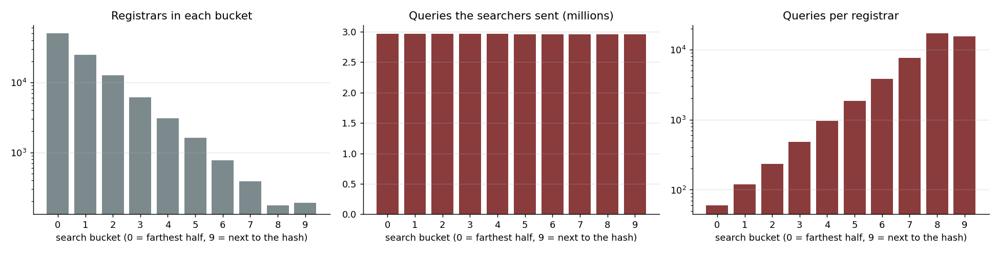
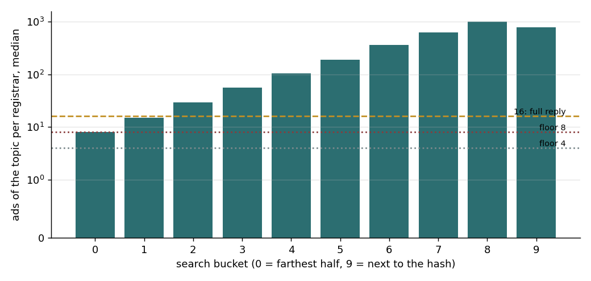
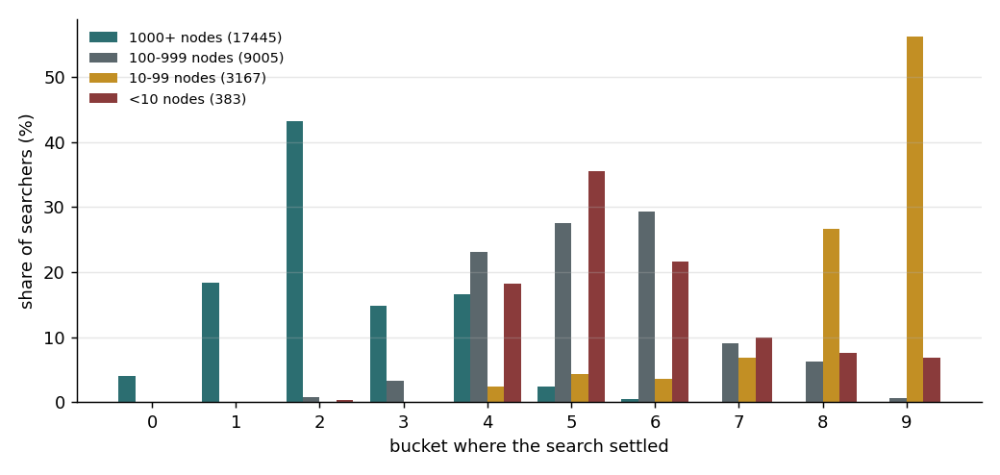
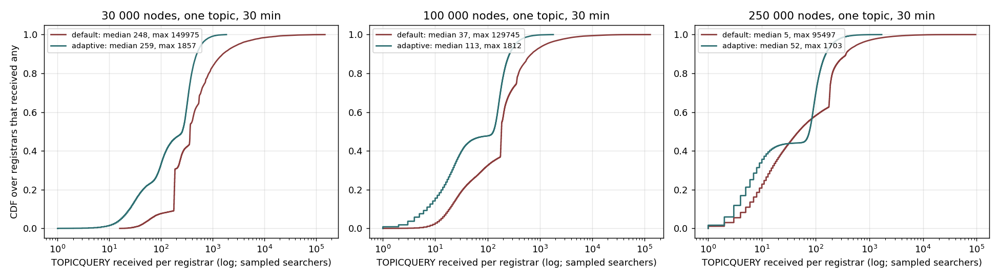
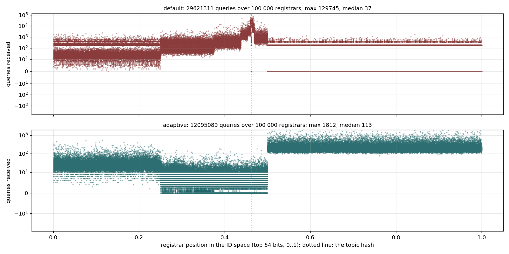
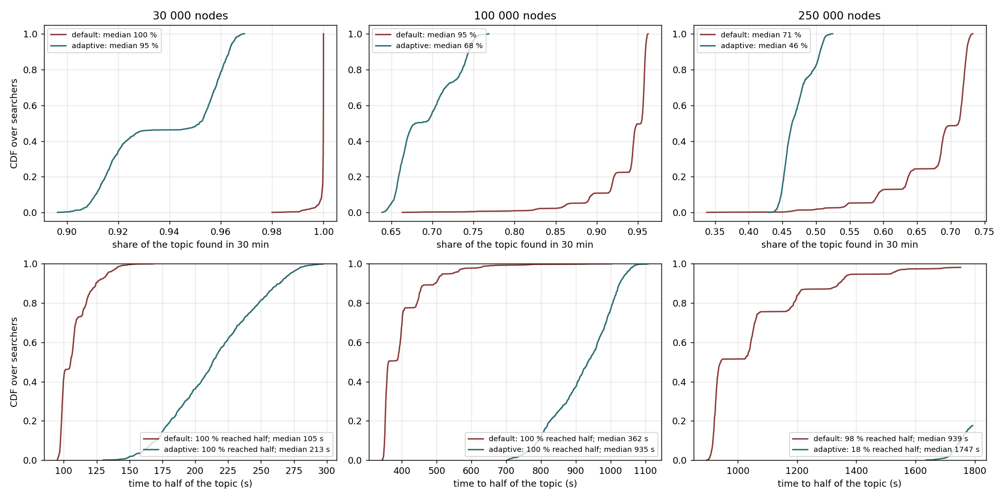
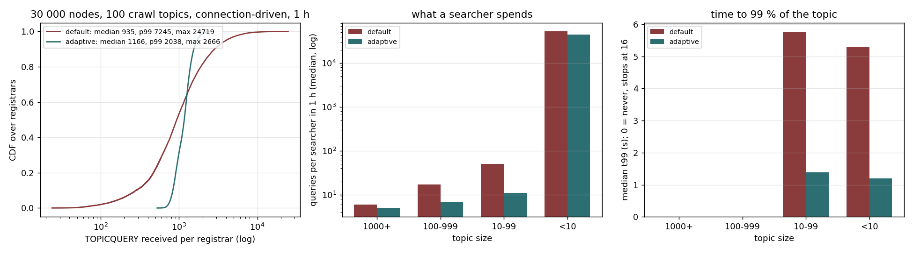

# Default and adaptive search in the model

The topic search as implemented has a load problem. One rule in the searcher fixes it. This document describes both and shows what the Python model of TopDisc measures at 30 000, 100 000 and 250 000 nodes. No testbed can run those sizes.

All numbers and figures come from the model with the aux-node fix (PR #2). The first version of this document used the model before that fix, and two of its conclusions changed: the rule now costs search time at every size with floor 4, and floor 4 is no longer the selected value. The runs here use floor 4 and aux nodes for every bucket, as before. [adaptive-search-parameters.md](adaptive-search-parameters.md) selects the values now in go-ethereum: floor 8, aux radius 1, a 60 s pass back-off and results mixed over 5 registrars.

| | |
|---|---|
| model | datahop/topdisc-sim, `searchsim.world`, with the aux-node fix |
| sizes | 30k, 100k, 250k, and 100 crawl topics at 30k |
| busiest registrar over the median | 605 to 7 at 30k, 19 099 to 33 at 250k |
| share of a 100k topic found in 30 min | 95 % default, 68 % with floor 4 |

## 1. The problem

TopDisc has two halves. Only one of them regulates its own load. Registration does. A registrar quotes every advertiser a waiting time. The wait grows with the fill level of the cache and with the share the topic already takes. The registrars near a popular topic's hash receive every advertiser, so they slow admissions down. The ads then spread out to ten distances from the hash. Ads exist everywhere in the ID space, denser with each step closer to the hash. A searcher can find its topic from anywhere.

The search has no such mechanism. A registrar answers every query it receives. There is no waiting time and no refusal. Where searchers choose to ask is the only thing that decides how the query load falls on registrars. The search as implemented chooses badly.

The search table sorts registrars into ten buckets by distance to the hash. Bucket 0 is the farthest half of the ID space. Bucket 9 is the neighbourhood of the hash. The searcher opens one more bucket per round, farthest first. Then it picks any unasked node of any open bucket with equal probability. So each open bucket gets the same number of queries, whatever its population. Bucket 0 holds half of all registrars. Bucket 9 holds a few hundred. The same number of queries spread over 50 000 registrars is nothing. Spread over 200 registrars it is everything. When a pass runs out of unasked nodes, the next pass rebuilds the table from the same routing table. It asks the same seed nodes again, two seconds later, for as long as the node searches.



*The default searcher at 100 000 nodes, one topic, 30 minutes. Left: the registrars in each search-table bucket. Middle: the queries the searchers sent to each bucket. Right: the queries per registrar in each bucket.*

The middle panel shows the search rule at work. The default sends about 3 million queries to each bucket, from bucket 0 with 50 000 registrars to bucket 9 with 192. The right panel shows the result per registrar. A node in the far bucket answers 59 queries in the half hour. A node in bucket 8, next to the hash, answers 17 000, about 290 times more, for no reason other than its ID. Admission control would push back at buckets 8 and 9. The search never does. That is the hotspot. At 30 000 nodes the busiest registrar answers 605 times the median. At 250 000 nodes it answers 19 099 times the median.

## 2. The solution

Keep the table, the messages and the registrars as they are. Give the searcher the one thing it lacks, a sense of where it is worth asking. **Go where replies still carry ads. Never ask the same node twice within an ad lifetime.**



*What the rule reads. The bars are the median ads of one topic a registrar holds at each distance, from the model at 100 000 nodes: 8 in the farthest bucket, about 1 000 next to the hash. Registration places the ads, so the bars are the same under either searcher. A reply carries at most 16 ads. The rule reads a reply against two thresholds. At 16 the reply is full and the search steps one bucket farther out. Between the floor and 15 the search stays. Below the floor it moves closer. The lines mark floor 4, used in the runs of this document, and floor 8, the selected value.*

The search keeps an *active bucket*. It reads every reply as a measurement of ad density at that distance:

```
on every reply from a node in bucket b, carrying n ads:
    window[b] = last 4 values of n seen from bucket b
    if len(window[b]) >= 2:                  # one reply never moves the search
        m = median(window[b])
        if   m == 16: active = b - 1         # full reply: denser than a reply can show, step farther out
        elif m >= F:  active = b             # dense enough: stay (F is the floor: 4 here, 8 selected)
        elif m >= 1:  active = b + ceil(log2(F / m))   # density doubles per bucket: as many steps as it takes to reach F
        else:         active = b + 4         # nothing here: the largest step allowed
    asked.add(node) for one ad lifetime      # never re-ask it before its ads could have changed
    file the aux nodes of the reply into their buckets

to choose the next node to query:
    for distance d = 0, 1, 2, ...:           # active bucket first, then its neighbours, farther side first
        for bucket in (active - d, active + d):
            if bucket has a node not in asked: return it
    if a spare already-asked node was offered this pass: ask it once, for its aux nodes only
    end the pass; next pass starts one bucket closer, where the nodes are different ones
```

A jump moves at most four buckets and stays inside the table. Every query lists the distances the searcher wants refilled. The registrar attaches one node per distance from its routing table. That is the only change on the registrar side. It is how the walk keeps finding new nodes at the distance where it settled. The wire format does not change. The rule is off unless the yield floor is set. Old and new nodes interoperate.

The effect is that a search settles where the ads of its topic reach the floor. For a large topic the far registrars already hold several ads each. The search stays in the outer buckets, and the load spreads over half the ID space. For a small topic the far replies are empty. The search jumps inward until replies carry as many ads as the floor. It settles close to the hash, where the few ads of that topic are.



*The bucket where each adaptive search settled, by the size of its topic, in the 30 000-node run with the 100 crawl topics of section 7.*

Searches on topics of a thousand members or more settle in bucket 2 at the median, far from the hash. Searches on topics of 100 to 999 members settle in bucket 5, and on topics of 10 to 99 members in bucket 9, next to the hash. The size of the topic decides how far from the hash its searchers stay, and so how many registrars share their load. Topics under 10 members settle in bucket 5 at the median: their searchers never fill their slots, so they walk the table for the whole hour.

## 3. The model and the scenarios

The Python model ports the registration walk, the admission rule with its lower bounds, and both searchers onto one event loop. The population is a sorted array of random IDs. The model generates DHT tables on demand. It weights them so that early-started nodes sit in more tables, as real routing tables do. The model stores nothing per node. That is why it runs 250 000 nodes in half an hour on one machine.

We checked the model against the 10 000-node simnet runs with the crawl topic mix. It reproduces the fan-out, 36 registrars per registrant at the median against 36 measured. It reproduces the queries per search for each topic size. It places the adaptive searcher's settled bucket within one bucket of the measured one. It puts the registrar load median and p99 within a factor of two. It does not reproduce the extreme maximum of the default searcher. That value stays about seven times under the measured one. The maximum comes from which nodes sit in everyone's routing tables, and the model's weighting captures about a quarter of the real bias. The maxima of the default searcher below are therefore lower bounds. Read everything else as measured. The validation covers load and queries per search. It does not cover time to recall; on that, the fixed model and the testbed now agree (section 6).

### The scenarios

Four scenarios, each run twice with the same seed: once with the default searcher and once with the rule. The only difference between the two runs of a pair is the yield floor, 0 for the default and 4 for the rule. Three scenarios have one topic and grow the network. The fourth puts the topic mix of the crawl on 30 000 nodes.

| scenario | nodes | topics | who registers | who searches | lookup model | search phase |
|---|---|---|---|---|---|---|
| single topic, 30k | 30 000 | 1 | every node | 885 nodes, 3 % | continuous | 30 min |
| single topic, 100k | 100 000 | 1 | every node | 1 019 nodes, 1 % | continuous | 30 min |
| single topic, 250k | 250 000 | 1 | every node | 966 nodes, 0.4 % | continuous | 30 min |
| crawl mix, 30k | 30 000 | 100, sizes from the crawl of 2026-09-18 | half of the nodes, one topic each | every node, its own topic | until 16 distinct members are found | 60 min |

Every run has the same timeline. Nodes start over the first 15 minutes. Registration then runs alone for 22.5 minutes, so the ads are in place before the first search. The search phase starts after that and lasts 30 or 60 minutes. The searchers start staggered, 0.1 s apart in the single-topic runs and 0.03 s apart in the mix. A continuous searcher never stops. It keeps its search open for the whole phase, as a node with free peer slots would. A connection-driven searcher stops when it holds 16 distinct members of its topic.

The protocol parameters are the ones of the geth implementation. The search table has 10 buckets of 16 nodes. A registrar caches 5 000 ads and quotes waiting times from the same admission rule with its lower bounds. A reply carries at most 16 topic nodes and 8 aux nodes. An ad lives 15 minutes. Every query costs 60 ms of round trip. Routing tables use the spawn-order weighting described above and no bootnodes. The rule runs with a yield floor of 4 and an aux radius of 0, the values of the first evaluation. The selected values are in adaptive-search-parameters.md.

The single-topic runs sample the searchers, so the registrar loads in sections 4 and 5 are per sampled run. They scale with the number of searchers. The ratios between the two searchers, and between buckets, do not depend on the sample. In the mix every node searches, so the loads of section 7 are the loads of the whole network.

## 4. Evaluation: registrar load



*Queries received per registrar over 30 minutes, one topic, about a thousand continuous searchers, at three sizes. The axis is logarithmic.*

| nodes | queries per registrar, median / p99 / max, default | same, adaptive | max ÷ median | total queries |
|---|---|---|---|---|
| 30 000 | 248 / 12 455 / 149 975 | 259 / 967 / 1 857 | 605 → 7.2 | 26.8 M → 7.5 M |
| 100 000 | 37 / 3 827 / 129 745 | 113 / 600 / 1 812 | 3 507 → 16 | 29.6 M → 12.1 M |
| 250 000 | 5 / 1 574 / 95 497 | 52 / 357 / 1 703 | 19 099 → 33 | 30.0 M → 16.5 M |

The rule spreads the queries instead of concentrating them, and the adaptive searchers send fewer of them: a quarter to a half of the default's total. The adaptive distribution is narrow at every size. Its p99 is within seven times the median and its maximum stays under 2 000 queries. The median of the default falls with size, because most registrars barely see the searchers. Its maximum stays near 100 000. The same handful of nodes near the hash answers every searcher, however large the network. At 250 000 nodes one registrar answers 19 099 times the median with the default and 33 times with the rule. That residual comes from the routing-table bias, not from the search.

## 5. Evaluation: where the load goes



*Search load by position in the ID space, 100 000 nodes, one topic. The dotted line is the topic hash. With the default, 73 % of the registrars in the far half are never asked. Its load doubles with each step of the table toward the hash: the 400 registrars nearest the hash answer 15 600 queries each on average. The adaptive load is flat across the space, about 120 per registrar, and the registrars nearest the hash are almost never asked.*

The default searcher opens the farthest bucket first. That bucket is half the ID space and holds sixteen candidates at a time. So the searcher never reaches most of its registrars, and everyone reaches the few in the closest buckets. The adaptive searcher asks where ads are dense enough to be worth a query. It refills its table with new nodes at that distance. So every registrar of a popular topic gets a share. The ones at the hash get almost none, because their full replies push the search outward.

## 6. Evaluation: what searchers get



*Top: the share of the topic each searcher found in 30 minutes. Bottom: the time to reach half of the topic.*

| nodes | found in 30 min, median, default / adaptive | time to half, median | time to 90 % |
|---|---|---|---|
| 30 000 | 100 % / 95 % | 105 s / 213 s | 401 s / 1 297 s |
| 100 000 | 95 % / 68 % | 362 s / 935 s | 1 263 s (89 % got there) / never |
| 250 000 | 71 % / 46 % | 939 s / 1 747 s (18 % got there) | never / never |

With floor 4 the rule costs search time at every size: the adaptive searcher finds less of its topic and takes about twice as long to half of it. This agrees with the testbed, where floor 4 was 1.6 to 1.8 times slower to 99 % at 858 and 5 000 nodes. The first version of this document predicted the opposite at 100 000 nodes; that prediction came from the model defect.

The reason is the floor. With floor 4 a search settles where replies carry about four ads, far from the hash, and sends a quarter of the default's queries. It finds its topic slowly because it asks where ads are sparse. A higher floor moves the search closer to the hash. In [adaptive-search-parameters.md](adaptive-search-parameters.md), floor 8 reaches 90 % of a 30 000-node topic in 377 s, as fast as the default, with half of its queries and a busiest registrar at 2 000 instead of 150 000.

## 7. Evaluation: the crawl mix



*Every node registers one topic drawn with the sizes of the crawl and searches it until its 16 slots are full. Left: queries per registrar. Middle: the queries a searcher makes in the hour, by the size of its topic. Right: the time to 99 % of the topic, for the sizes where a searcher can reach it.*

| measure | default | adaptive |
|---|---|---|
| queries per registrar, median / p99 / max | 935 / 7 245 / 24 719 | 1 166 / 2 038 / 2 666 |
| queries per searcher in 1 h, topics of 1000+ / 100–999 / 10–99 / under 10 | 6 / 17 / 51 / 52 548 | 5 / 7 / 11 / 45 129 |
| time to 99 % of the topic, median, topics of 10–99 / under 10 | 5.8 s / 5.3 s | 1.4 s / 1.2 s |
| searchers of topics under 10 that found all of it | 100 % | 100 % |

On the mix the busiest registrar comes down nine times and the p99 3.6 times. Large-topic searchers spend about the same five or six queries to fill their slots. The gain on the searcher side is on smaller topics: a node on a topic of 10 to 99 members needs 11 queries instead of 51, and reaches 99 % of it in 1.4 s instead of 5.8 s. The search jumps to the distance where the ads of that topic are, instead of walking in from the far end. Nodes on topics with fewer than sixteen members never fill their slots and search all hour. They make 52 000 queries each with the default and 45 000 with the rule. They are the top of the registrar load in every mixed run. That is the re-walk loop. A back-off between passes that found nothing new cuts the busiest registrar from 25 696 to 5 028 queries for the default and from 2 806 to 565 for the adaptive searcher, with the same recall. An aux radius of 1 cuts the queries of the mix from 35.4 million to 2.7 million. Both are measured in adaptive-search-parameters.md.

## 8. Conclusion

- The hotspot is a property of the search, not of registration. The default searcher gives every open bucket the same share and asks its seed nodes again every pass. So everyone asks the registrars near the hash.

- One rule removes it. Move the active bucket by the ad counts that replies carry. Do not ask a node again within an ad lifetime. The busiest registrar over the median falls from 605 to 7 at 30k and from 19 099 to 33 at 250k, with fewer total queries.

- With floor 4 the rule costs search time at every size, in the fixed model as on real nodes. A higher floor removes that cost: floor 8 is as fast as the default at 30k with half its queries.

- Selected values (adaptive-search-parameters.md): yield floor 8, aux radius 1, a 60 s pass back-off, results mixed over 5 registrars. The residual skew is the routing-table bias.

## Sources

| what | where |
|---|---|
| model | datahop/topdisc-sim, `searchsim.world`. The README has the validation |
| runs | London, runs/2026-09-29-sim-auxfix/runs, the fixed-model reruns: sweep-default and sweep-floor4 (30k), single100k-cont-f0 and -f4, s250k-default and s250k-floor4, sweep2-default and sweep2-floor4 (mix) |
| figures | drawn from each run's summary.json, searches.json, ids.npy, tq_rcv.npy and held.npy |
| the rule in the fork, and the testbed and AWS measurements referred to | datahop/go-ethereum, branch topicsearch-adaptive-distance, docs/topic-search-adaptive-distance.md |
