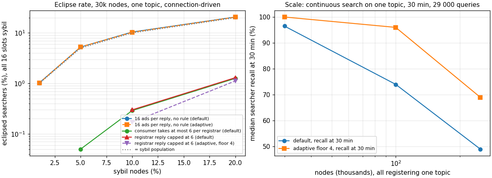

# Admission-control security: sybil registrars and eclipse

Phase 3 plan §6, evaluated with `searchsim.world` (datahop/go-ethereum#124).
Every run: 30 000 nodes, connection-driven search (a node stops at 16
registrants), adaptive distance with yield floor 4 unless stated, one hour.
Sybils are ordinary nodes that register their own IDs, answer every TOPICQUERY
with sybil ads only and refer sybils as aux nodes. Per honest searcher the
model records the share of sybils among its results and whether it was
eclipsed: every one of its 16 slots a sybil.

## Decision

The search hands out its results through a mixer over 10 registrars
(`--fork-mix-registrars 10`): it waits until 10 registrars have results, then
takes one from each in turn, so no single registrar fills a node's 16 slots.
On top of it the search keeps at most 2 registrars per /24 in a bucket and at
most 10 registrars per /24 in one search. With these settings:

- Sybil registrars, 50 000 nodes, 20 % sybils on 100 /24s: 0.02 % of searchers
  get only sybils in their first 16 results, against 0.25 % with the mixer
  over 5 ([adaptive-search-parameters.md §3.7](adaptive-search-parameters.md#37-result-mixer)).
- Sybil advertisers flooding a topic or occupying the cache: no searcher
  eclipsed, honest recall 100 % ([capacity.md](capacity.md#results)).
- The A3 attack below is stopped by the per-search /24 limit, not by the mixer.

The first three tables were run before the mixer existed: one reply could
fill all 16 slots. They show why a rule is needed and what the reply cap
would have cost.

## One topic: eclipse rate against the sybil population (pre-mixer)

| rule | eclipsed at 5 / 10 / 20 % sybils | mean sybil share of results at 10 / 20 % | queries per node |
|---|---|---|---|
| none, 16 ads per reply (default and adaptive alike) | 5.3 % / 10.4 % / 20.7 % | 0.25 / 0.45 | 2 |
| consumer keeps at most 6 results per registrar (so at least 3 registrars) | 0.05 % / 0.29 % / 1.3 % | 0.20 / 0.38 | 3 |
| registrar reply capped at 6 ads | – / 0.30 % / 1.3 % | 0.20 / 0.38 | 3 |



Without a rule the eclipse rate equals the sybil fraction: one reply fills
all 16 slots, so the first registrar decides. With 6 per registrar, enforced
on either side, three registrars are needed and the rate falls to about the
sybil fraction cubed. The adaptive distance neither helps nor hurts: both
searchers take two queries and the first decides. A sybil registrar still
fills 6 of 16 slots, which is where the median share of 0.375 at 20 % comes
from; a cap of 4 would need four sources.

## Crawl mix: eclipse by topic size (pre-mixer)

10 % sybils over the 100 crawl topics (`models/crawl-2026-09-18.json`).

| configuration | 1000+ members: eclipsed, share | 100–999 | 10–99 | under 10 |
|---|---|---|---|---|
| default, 16 ads per reply | 14.9 %, 0.46 | 29.8 %, 0.78 | 0 %, 0.24 | 2.1 %, 0.15 |
| adaptive, 16 ads per reply | 14.4 %, 0.42 | 22.3 %, 0.61 | 0 %, 0.24 | 2.1 %, 0.13 |
| default, reply capped at 6 | 0.8 %, 0.32 | 5.7 %, 0.65 | 0 %, 0.24 | 2.1 %, 0.15 |
| adaptive, reply capped at 6 | 1.9 %, 0.31 | 8.5 %, 0.52 | 0 %, 0.24 | 2.1 %, 0.13 |
| default, cap 6 and results from 2 distance buckets | 0.8 %, 0.32 | 5.7 %, 0.64 | 0 %, 0.24 | 2.1 %, 0.15 |
| adaptive, cap 6 and results from 2 distance buckets | 1.4 %, 0.31 | 7.8 %, 0.54 | 0 %, 0.24 | 2.1 %, 0.13 |

On the mix the attacker does better than on one topic: a sybil registrar's
reply also carries sybil aux nodes, so the searcher's table fills with sybils
and the next query is more likely to hit one. The cap cuts the eclipse rate
10 to 20 times but not to the cube of the population, because the referral
channel is untouched. Requiring results from two distance buckets adds
nothing on top of the cap. Topics of 10 to 99 members are never eclipsed
because their searchers cannot fill 16 slots from one topic's sybils and keep
searching; those under 10 show the population rate. The model gives every
sybil a distinct address; the per-/24 limits on aux nodes that the
implementation has would blunt the referral channel for an attacker with few
prefixes.

## What the reply cap costs (pre-mixer)

| workload, 30 000 nodes | 16 ads per reply | 6 ads per reply |
|---|---|---|
| one topic, continuous, default: recall at 30 min, t50 | 96.5 %, 201 s | 82.6 %, 499 s |
| one topic, continuous, adaptive: recall at 30 min, t90 | 100 %, 348 s | 97.9 %, 1 006 s |
| one topic, registrar queries median / p99 / max, adaptive | 547 / 1 054 / 1 753 | 569 / 1 084 / 1 781 |
| crawl mix, connection-driven: queries per node, topics of 1000+ / under 10 | 6 / 29 106 | 6 / 29 098 |
| crawl mix, registrar queries median / p99 / max, adaptive | 791 / 1 326 / 2 033 | 794 / 1 327 / 2 067 |

Connection-driven nodes and the registrar load do not notice the cap: a
searcher's query count is set by its walk, not by the reply size. Continuous
searchers do: the tail of a large topic takes three times longer and recall
at 30 min drops by 2 to 14 points. Bytes per reply fall by 60 %.

Confirmed in simnet (5 000 real nodes, adaptive, 1 h continuous, 16 against 6
ads per reply): single topic t50 / t90 / t99 from 131 / 602 / 1 340 s to
335 / 1 419 / 2 879 s at 100 % recall on both; five topics t99 of the largest
from 423 to 849 s; registrar query medians up 3 to 20 %, maxima unchanged;
bytes sent per node p95 down from 48 to 30 MB.

## The paper's rule

The service-discovery paper prescribes N_return = 10 results per registrar
against N_lookup = 30 needed and K_lookup = 5 registrars queried in parallel,
so no registrar can fill a lookup alone. The implementation lost that:
both limits are 16 and one query is in flight, so one reply fills a
connection-driven node. The mixer over 10 registrars restores the property.

## IP limits per search

The search table is rebuilt every pass, so a per-bucket /24 limit has no memory: an attacker
holding a few /24s can place a fresh sybil ID in every bucket on every pass. Here the attacker
holds 2 /24s, and its registrars answer with no advertisements until the search reaches the
closest bucket, then with 11 useless ones, and refer other sybils as auxiliary ENRs for the
closest buckets (`--attack A3`). 30,000 nodes, all registered, one topic per crawl chain (455
topics), honest addresses from the 24 h mainnet crawl (`--honest-nets crawl`), 3 % of nodes
searching for 2,700 s (918 searchers), mixer over 10 registrars, one seed. The limits compared
are 2 registrars per /24 in a bucket (`--search-bucket-ip-limit 2`) and at most N distinct node
IDs per /24 in one search, each counted for one ad lifetime (`--w1p --w1p-limit N`). Sybil share
is the mean share of sybils among a pass's queries; recall, the searchers reaching 90 % and t90
count honest providers only.

Under the attack:

| Limits | Sybil share of queries | Passes with no honest query | Recall | Searchers reaching 90 % | Mean t90 |
|---|---:|---:|---:|---:|---:|
| 1 per bucket, none per search | 93.6 % | 1,129,336 | 96.6 % | 838 / 918 | 1,209 s |
| 2 per bucket, none per search | 92.2 % | 1,119,025 | 72.0 % | 534 / 918 | 1,219 s |
| 2 per bucket, 10 per search | 0.65 % | 1,614 | 100 % | 918 / 918 | 136 s |

The mixer changes these numbers little: A3 does not need one reply to fill the slots, it takes
the search's queries pass after pass. The per-search limit stops it. Without the
mixer the same three rows gave a sybil share of 92.8 %, 92.1 % and 0.63 %. With no attack, the
limits of 2 per bucket and 10 per search raise the mean t90 from 104.6 s to 123.9 s, with recall
at 100 % (pre-mixer runs). Per-search limits of 1 and 2 also stop the attack, with a sybil share
of 0.07 % and 0.13 %, but raise the mean t90 with no attack to 273 s and 175 s (pre-mixer runs).
The attacker's allowance grows by 10 with each further /24.

`MODEL` is the chain model: one topic per crawl chain, with the chain's share of nodes.

```sh
python3 -m searchsim.world --nodes 30000 --topics 455 --model MODEL --all-register --target 0 \
  --search-frac .03 --search-time 2700 --fork-faithful --honest-nets crawl \
  --fork-mix-registrars 10 --attack A3 --attack-nets 2 --search-bucket-ip-limit 2 \
  --w1p --w1p-limit 10 --seed 1 --out runs/a3-w1p10/
```

## Why the mixer and not the reply cap

Both get the cube. The reply cap of 6 needs no consumer change but costs continuous searchers
the tail of large topics (above). The mixer keeps 16 ads per reply and the tail, and interleaves
at the consumer, which tracks the source of each result. The referral channel is open in both;
the per-/24 limits of the search close it for an attacker with few prefixes.

Pre-mixer runs: `runs/sybil`, `runs/sybil3`, `runs/cap6`, `runs/sybilmix` on London,
`python3 -m searchsim.world --sybil-frac ... --topic-nodes-limit ... --min-sources ... --min-buckets ...`.
