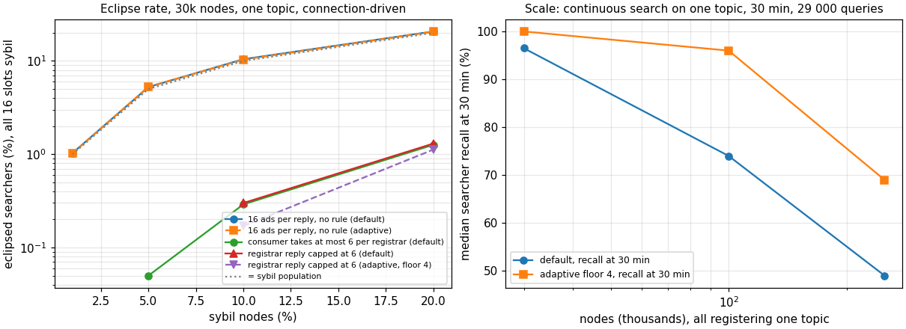

# Admission-control security: sybil registrars and eclipse

Phase 3 plan §6, evaluated with `searchsim.world` (datahop/go-ethereum#124).
Every run: 30 000 nodes, connection-driven search (a node stops at 16
registrants), adaptive distance with yield floor 4 unless stated, one hour.
Sybils are ordinary nodes that register their own IDs, answer every TOPICQUERY
with sybil ads only and refer sybils as aux nodes. Per honest searcher the
model records the share of sybils among its results and whether it was
eclipsed: every one of its 16 slots a sybil.

## One topic: eclipse rate against the sybil population

| rule | eclipsed at 5 / 10 / 20 % sybils | mean sybil share of results at 10 / 20 % | queries per node |
|---|---|---|---|
| none, 16 ads per reply (default and adaptive alike) | 5.3 % / 10.4 % / 20.7 % | 0.25 / 0.45 | 2 |
| consumer keeps at most 6 results per registrar (so at least 3 registrars) | 0.05 % / 0.29 % / 1.3 % | 0.20 / 0.38 | 3 |
| registrar reply capped at 6 ads | – / 0.30 % / 1.3 % | 0.20 / 0.38 | 3 |

Without a rule the eclipse rate equals the sybil fraction: one reply fills
all 16 slots, so the first registrar decides. With 6 per registrar, enforced
on either side, three registrars are needed and the rate falls to about the
sybil fraction cubed. The adaptive distance neither helps nor hurts: both
searchers take two queries and the first decides. A sybil registrar still
fills 6 of 16 slots, which is where the median share of 0.375 at 20 % comes
from; a cap of 4 would need four sources.

## Crawl mix: eclipse by topic size

10 % sybils over the 100 crawl topics (`models/crawl-2026-09-18.json`).

| configuration | 1000+ members: eclipsed, share | 100–999 | 10–99 | under 10 |
|---|---|---|---|---|
| default, 16 ads per reply | 14.9 %, 0.46 | 29.8 %, 0.78 | 0 %, 0.24 | 2.1 %, 0.15 |
| adaptive, 16 ads per reply | 14.4 %, 0.42 | 22.3 %, 0.61 | 0 %, 0.24 | 2.1 %, 0.13 |
| default, reply capped at 6 | 0.8 %, 0.32 | 5.7 %, 0.65 | 0 %, 0.24 | 2.1 %, 0.15 |
| adaptive, reply capped at 6 | 1.9 %, 0.31 | 8.5 %, 0.52 | 0 %, 0.24 | 2.1 %, 0.13 |
| default, cap 6 and results from 2 distance buckets | 0.8 %, 0.32 | 5.7 %, 0.64 | 0 %, 0.24 | 2.1 %, 0.15 |
| adaptive, cap 6 and results from 2 distance buckets | 1.4 %, 0.31 | 7.8 %, 0.54 | 0 %, 0.24 | 2.1 %, 0.13 |

On the mix the attacker does better than on one topic: a sybil registrar's
reply also carries sybil aux nodes, so the searcher's table fills with sybils
and the next query is more likely to hit one. The cap cuts the eclipse rate
10 to 20 times but not to the cube of the population, because the referral
channel is untouched. Requiring results from two distance buckets adds
nothing on top of the cap. Topics of 10 to 99 members are never eclipsed
because their searchers cannot fill 16 slots from one topic's sybils and keep
searching; those under 10 show the population rate. The model gives every
sybil a distinct address; the per-/24 limits on aux nodes that the
implementation has would blunt the referral channel for an attacker with few
prefixes.

## What the reply cap costs

| workload, 30 000 nodes | 16 ads per reply | 6 ads per reply |
|---|---|---|
| one topic, continuous, default: recall at 30 min, t50 | 96.5 %, 201 s | 82.6 %, 499 s |
| one topic, continuous, adaptive: recall at 30 min, t90 | 100 %, 348 s | 97.9 %, 1 006 s |
| one topic, registrar queries median / p99 / max, adaptive | 547 / 1 054 / 1 753 | 569 / 1 084 / 1 781 |
| crawl mix, connection-driven: queries per node, topics of 1000+ / under 10 | 6 / 29 106 | 6 / 29 098 |
| crawl mix, registrar queries median / p99 / max, adaptive | 791 / 1 326 / 2 033 | 794 / 1 327 / 2 067 |

Connection-driven nodes and the registrar load do not notice the cap: a
searcher's query count is set by its walk, not by the reply size. Continuous
searchers do: the tail of a large topic takes three times longer and recall
at 30 min drops by 2 to 14 points. Bytes per reply fall by 60 %.

Confirmed in simnet (5 000 real nodes, adaptive, 1 h continuous, 16 against 6
ads per reply): single topic t50 / t90 / t99 from 131 / 602 / 1 340 s to
335 / 1 419 / 2 879 s at 100 % recall on both; five topics t99 of the largest
from 423 to 849 s; registrar query medians up 3 to 20 %, maxima unchanged;
bytes sent per node p95 down from 48 to 30 MB.

## The paper's rule

The service-discovery paper prescribes N_return = 10 results per registrar
against N_lookup = 30 needed and K_lookup = 5 registrars queried in parallel,
so no registrar can fill a lookup alone. The implementation lost that:
both limits are 16 and one query is in flight, so one reply fills a
connection-driven node. Either defence above restores the property.

## Decision needed

Two ways to get the cube: cap the reply at the registrar (`topicNodesResultLimit`
6, no consumer change, the cost above) or keep 16 per reply and have the
search iterator interleave results so that no 16 consecutive results come from
one registrar (consumer side, keeps the tail, needs source tracking in the
iterator). The referral channel stays open in both; the per-/24 aux limit is
the next lever there. Not evaluated here: the admission IP-diversity score against
a sybil cluster on one prefix (the model's IP term was zero for these runs;
`world` now applies the 703d5a2 rule with the IP term, see `capacity.md`).

Runs: `runs/sybil`, `runs/sybil3`, `runs/cap6`, `runs/sybilmix` on London,
`python3 -m searchsim.world --sybil-frac ... --topic-nodes-limit ... --min-sources ... --min-buckets ...`.
